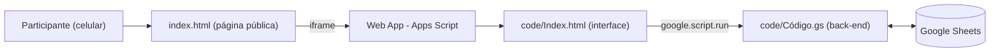

# Desafio Na Medida — Controle de Hábitos

Aplicação web **mobile-first** para acompanhar os hábitos saudáveis dos participantes do desafio **"Na Medida"** do SESI.
Cada participante procura o próprio nome, marca os hábitos que cumpriu no dia e acompanha quantos dias completou ao longo do desafio.

Os dados ficam salvos em uma **planilha do Google Sheets**, o que facilita para a organização acompanhar e analisar os resultados, sem precisar de servidor ou banco de dados.

> **Resultado:** o desafio durou **30 dias** e teve **120 usuários ativos** fazendo check-in pelo app.

---

## Funcionalidades

- **Busca de nome com autocomplete** — a lista de participantes vem direto da planilha e é filtrada enquanto a pessoa digita.
- **Check-in diário** de 8 hábitos:

  | Hábito | Ícone |
  |---|---|
  | Atividade do Dia | ❤️ |
  | Desafio Ouro | 🏅 |
  | 2L de Água | 💧 |
  | Verdura / Legumes | 🥬 |
  | Fruta | 🍎 |
  | Musculação | 🏋️ |
  | Caminhada / Corrida | 🏃 |
  | Atividade Extra | ⭐ |

- **Calendário semanal navegável** — dá para voltar ou avançar semanas e tocar em qualquer dia para **ver ou editar um check-in retroativo**.
- **Indicador visual** — os dias com check-in salvo aparecem com a bolinha verde; o dia atual fica destacado.
- **Edição sem duplicar dados** — se já existe registro daquele participante naquela data, a linha é atualizada em vez de criar outra.
- **Aba "Resumo do mês"** — mostra quantos dias cada hábito foi cumprido ao longo do desafio (ex.: `12/30 dias`). O total é fixo em **30** porque o desafio foi pensado para durar exatamente 30 dias.
- **Pronto para celular** — pode ser adicionado à tela inicial (ícone próprio e modo de app).

---

## Tecnologias

| Camada | Tecnologia |
|---|---|
| Back-end | [Google Apps Script](https://developers.google.com/apps-script) (JavaScript) |
| Banco de dados | Google Sheets |
| Front-end | HTML, CSS e JavaScript puro (sem frameworks) |
| Ícones | [Phosphor Icons](https://phosphoricons.com/) |
| Hospedagem | Web App do Apps Script + `index.html` (ex.: GitHub Pages) |

---

## Como funciona



1. O participante acessa o `index.html`, que carrega o Web App do Apps Script dentro de um `iframe` (assim o link fica mais amigável e com ícone próprio).
2. O `Código.gs` entrega a interface (`Index.html`) pela função `doGet()`.
3. A interface conversa com o back-end usando `google.script.run`, chamando as funções:

| Função | O que faz |
|---|---|
| `obterNomes()` | Lê a lista de participantes da aba **Resumo** (coluna A) e devolve em ordem alfabética. |
| `buscarTudoUsuario(nome)` | Lê a aba **Registros**, monta o histórico dia a dia do participante e soma o total de cada hábito. |
| `salvarRegistro(dados)` | Grava o check-in na aba **Registros** — atualiza a linha se já existir registro naquela data ou cria uma nova. |

---

## Estrutura do projeto

```
desafio-na-medida/
├── README.md
├── index.html        # Página pública: favicon/ícone + iframe para o Web App
└── code/
    ├── Código.gs     # Back-end em Google Apps Script
    └── Index.html    # Interface (HTML + CSS + JS) servida pelo Apps Script
```

---

## Estrutura da planilha

A planilha precisa ter **duas abas**:

**`Resumo`** — lista de participantes

| A |
|---|
| Nome (a partir da linha 2) |

**`Registros`** — um check-in por linha (linha 1 é o cabeçalho)

| A | B | C | D | E | F | G | H | I | J |
|---|---|---|---|---|---|---|---|---|---|
| Data | Nome | Atividade do Dia | Desafio Ouro | Água | Verdura | Fruta | Musculação | Corrida | Extra |

Os hábitos são gravados como `Sim` ou `Não`.

---

## Como publicar a sua própria versão

1. Crie uma planilha no Google Sheets com as abas `Resumo` e `Registros` (estrutura acima).
2. Na planilha, abra **Extensões → Apps Script**.
3. Copie o conteúdo de [`code/Código.gs`](code/Código.gs) para o arquivo de script.
4. Crie um arquivo HTML chamado **`Index`** e cole o conteúdo de [`code/Index.html`](code/Index.html).
5. Troque a constante `ID_PLANILHA` pelo ID da sua planilha (o trecho da URL entre `/d/` e `/edit`).
6. Clique em **Implantar → Nova implantação → App da Web**:
   - *Executar como:* **Eu**
   - *Quem pode acessar:* **Qualquer pessoa**
7. Copie a URL gerada (termina em `/exec`) e coloque no `src` do `iframe` no [`index.html`](index.html).
8. Publique o `index.html` (por exemplo, no GitHub Pages) e compartilhe o link com os participantes.

> 💡 Para testar a interface localmente, dá para abrir o `index.html` com o Live Server (porta `5501`, configurada em `.vscode/settings.json`).

---

## Autoria

- **[Guilherme Santos](https://www.linkedin.com/in/guilhermee-santos/)** — idealização e desenvolvimento (back-end, integração com Google Sheets, lógica do calendário e do check-in).
- **[Hanna Albino](https://www.linkedin.com/in/halds/)** — UX/UI.
